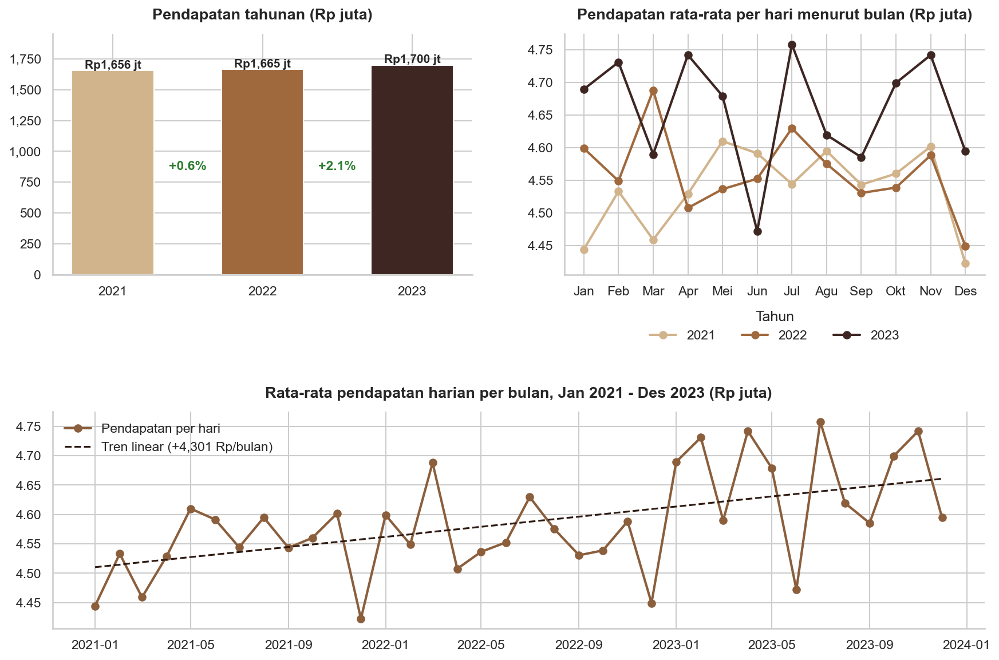
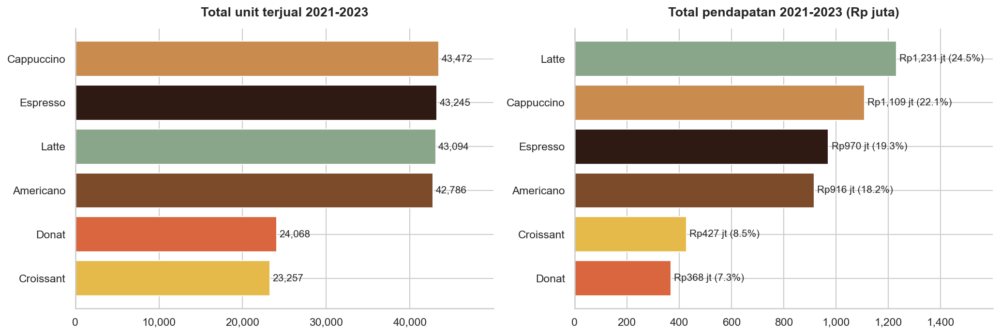
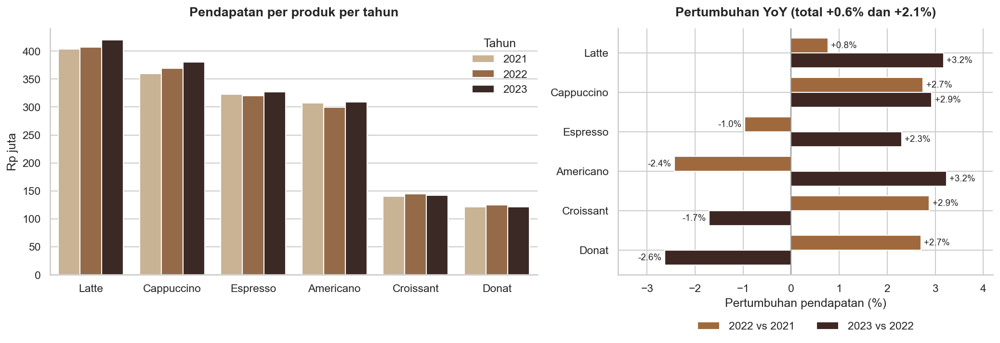
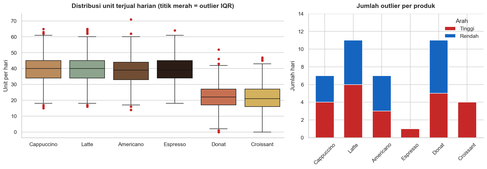
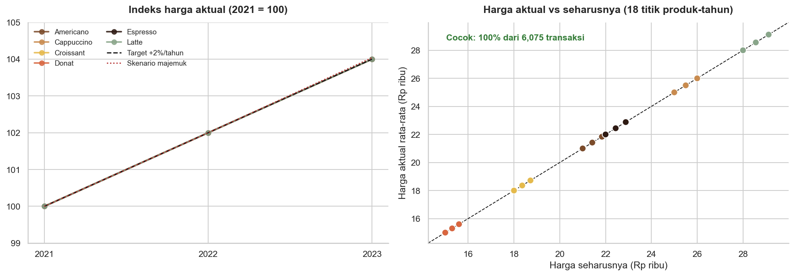
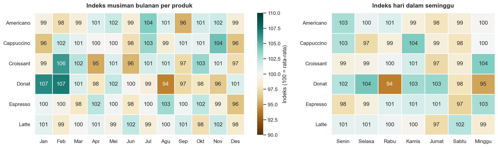

# Kopi Nangkau — Sales Analysis 2021–2023

Analisis penjualan harian sebuah kedai kopi (6 produk, 3 tahun) menggunakan **Python, Pandas, NumPy, Matplotlib, dan Seaborn**. Proyek ini mencakup pembersihan data, validasi kebijakan harga, EDA, analisis pertumbuhan, deteksi outlier, uji musiman, dan rekomendasi bisnis.



## Pertanyaan Bisnis

1. Produk mana yang paling berkontribusi pada pendapatan dan volume?
2. Seberapa cepat bisnis tumbuh, dan apa pendorongnya (harga atau volume)?
3. Apakah ada pola musiman atau hari dalam seminggu yang bisa dimanfaatkan?
4. Apakah kebijakan kenaikan harga 2% per tahun diterapkan konsisten?
5. Strategi apa yang paling menjanjikan untuk tahun berikutnya?

## Dataset

| Kolom                       | Keterangan                                               |
| --------------------------- | -------------------------------------------------------- |
| `Tahun`, `Bulan`, `Tanggal` | Tanggal transaksi (bulan berupa teks Indonesia)          |
| `Produk`                    | Americano, Cappuccino, Croissant, Donat, Espresso, Latte |
| `Unit_Terjual`              | Jumlah terjual per produk per hari                       |
| `Harga_Per_Unit`            | Harga satuan (Rp)                                        |

Data mentah: 6.600 baris. Masalah yang ditemukan: ±500 nilai kosong pada tiap kolom `Produk`, `Unit_Terjual`, dan `Harga_Per_Unit`, serta 19 baris duplikat persis.

## Pendekatan Cleaning

- **Pemulihan produk lewat harga.** Harga tiap produk unik per tahun, sehingga 463 nama produk yang kosong dapat dipulihkan tanpa menebak.
- **Duplikat.** Baris persis dihapus, baris ganda yang salah satu salinannya bolong digabung (tanpa nilai bertentangan).
- **Grid lengkap.** Data dibentuk menjadi 1 baris per produk per hari (6.570 baris), lalu unit kosong diimputasi dengan median produk-tahun-bulan. Imputasi diberi penanda `Unit_Imputasi`, dan analisis musiman dan outlier hanya memakai data asli.
- **Validasi harga.** Harga tercatat cocok 100% dengan skenario kenaikan 2% dari harga dasar 2021 setiap tahun (linear), bukan majemuk.

## Temuan Utama

| Temuan                                    | Angka                                          |
| ----------------------------------------- | ---------------------------------------------- |
| Total pendapatan 2021–2023                | **Rp5,02 miliar** (219.922 unit)               |
| Pertumbuhan pendapatan                    | +0,6% (2022), +2,1% (2023)                     |
| Pertumbuhan unit 2021→2023                | **-1,5%**, jadi pertumbuhan berasal dari harga |
| Produk pendapatan tertinggi               | **Latte**, 24,5% pendapatan                    |
| Produk unit tertinggi dan tumbuh tercepat | **Cappuccino**, +5,8% pendapatan sejak 2021    |
| Produk paling stagnan                     | **Donat**, pendapatan 0,0% dan unit -3,8%      |
| Porsi 4 minuman kopi                      | 84,2% pendapatan                               |
| Musiman                                   | **Tidak signifikan** (ANOVA p = 0,19–0,94)     |
| Outlier                                   | 41 dari 6.074 hari-produk (0,68%)              |

## Rekomendasi

1. **Bundling kopi + makanan**: rasio makanan terhadap kopi baru 27,4%; naik ke 35% menambah ≈ Rp73 juta/tahun (skenario ilustratif).
2. **Fokus pada Latte dan Cappuccino** (46,6% pendapatan) lewat upsell dan promosi.
3. **Hentikan penurunan volume** dengan program loyalitas atau promo jam sepi.
4. **Evaluasi Donat**: variasi rasa atau jadikan pendamping paket.
5. **Tidak perlu perencanaan musiman**; permintaan stabil sepanjang tahun.
6. **Perbaiki pencatatan data** dan tambahkan data biaya untuk analisis margin.

## Galeri Visual

|                                                             |                                                       |
| ----------------------------------------------------------- | ----------------------------------------------------- |
|            |   |
|  |  |



## Struktur Proyek

```
kopi-nangkau-sales-analysis/
├── data/
│   ├── penjualan_kopi_2021_2023.csv   # data mentah
│   └── penjualan_kopi_bersih.csv      # hasil cleaning (dibuat oleh notebook)
├── notebooks/
│   └── kopi_nangkau_sales_analysis.ipynb
├── images/                            # visual untuk README
├── requirements.txt
└── README.md
```

## Cara Menjalankan

```bash
git clone https://github.com/<username>/kopi-nangkau-sales-analysis.git
cd kopi-nangkau-sales-analysis
pip install -r requirements.txt
jupyter notebook notebooks/kopi_nangkau_sales_analysis.ipynb
```

Jalankan notebook dari folder `notebooks/` agar path relatif (`../data`, `../images`) berfungsi.

## Keterbatasan

- 7,5% unit hasil imputasi (7,8% dari pendapatan), sehingga total bergantung pada asumsi median.
- Tidak ada data biaya, margin, pelanggan, atau promo; "terbaik" berarti terbaik dalam pendapatan, bukan laba.
- Hanya 3 tahun data, jadi musiman yang sangat lemah sulit dibedakan dari noise.

## Tools

Python · Pandas · NumPy · Matplotlib · Seaborn · SciPy (uji ANOVA dan regresi tren)

## Penulis

**M Farhan Sugara**
